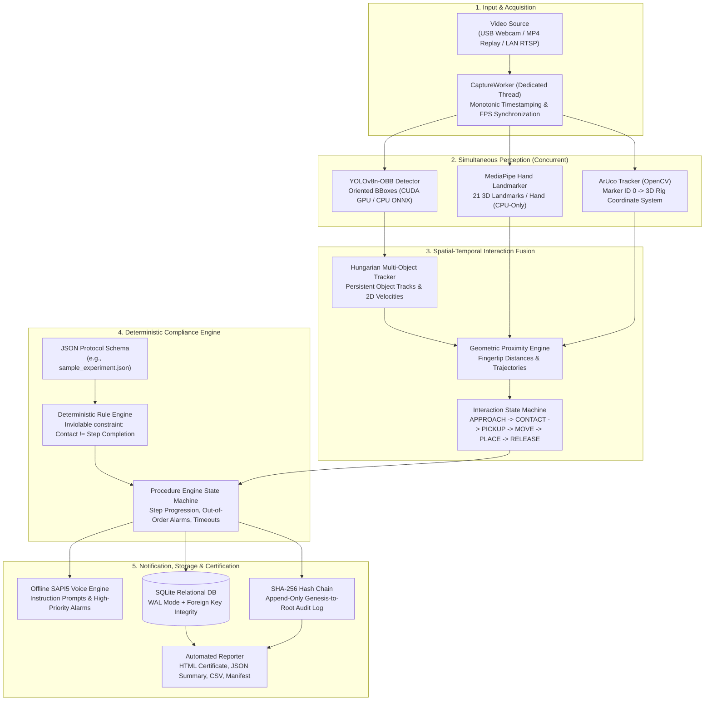

# VYOM — Offline Human Activity Recognition & Procedure Compliance Workstation

**Smart India Hackathon (SIH 26174)**  
**Target Environment:** Ground-based microgravity simulation, controlled gloveboxes, and laboratory workstations  
**Operational Status:** Production-Grade Research & Demonstration Workstation  

[](https://www.python.org/)
[-green.svg)](https://doc.qt.io/qtforpython-6/)
[](https://docs.ultralytics.com/)
[](#zero-network-guarantee)
[](#cryptographic-auditing)

---

> [!IMPORTANT]
> **Prototype Scope Statement:** VYOM is an offline-first research and demonstration prototype developed under SIH 26174. It is engineered for ground-based experiment monitoring and procedural training. It has not undergone DO-178C or NASA NPR 7150.2 flight-software qualification and must not be used as the sole authority in life-critical or hazardous operations.

---

## Table of Contents

1. [What Can You Do With VYOM?](#1-what-can-you-do-with-vyom)
2. [Workstation Architecture](#2-workstation-architecture)
3. [Quickstart: How to Use VYOM](#3-quickstart-how-to-use-vyom)
   - [Option A: Standalone Executable (No Python Required)](#option-a-standalone-executable-no-python-required)
   - [Option B: Running from Source](#option-b-running-from-source)
   - [Desktop Workstation User Guide](#desktop-workstation-user-guide)
4. [Setting Protocols & Procedures (Comprehensive Guide)](#4-setting-protocols--procedures-comprehensive-guide)
   - [Protocol Concepts & Schema](#protocol-concepts--schema)
   - [Complete JSON Protocol Schema Reference](#complete-json-protocol-schema-reference)
   - [Supported Interaction Event Types](#supported-interaction-event-types)
   - [Defining 3D Metric Rig Target Zones](#defining-3d-metric-rig-target-zones)
   - [Full Real-World Protocol Examples](#full-real-world-protocol-examples)
   - [Protocol Validation CLI](#protocol-validation-cli)
5. [Using Custom Datasets & Training Models](#5-using-custom-datasets--training-models)
   - [Object Class Taxonomy](#object-class-taxonomy)
   - [Data Collection & Camera Placement](#data-collection--camera-placement)
   - [Annotation Format: YOLO-OBB (Oriented Bounding Boxes)](#annotation-format-yolo-obb-oriented-bounding-boxes)
   - [Directory Structure & dataset.yaml](#directory-structure--datasetyaml)
   - [Training a Custom YOLOv8-OBB Checkpoint](#training-a-custom-yolov8-obb-checkpoint)
   - [ONNX Export & Parity Verification](#onnx-export--parity-verification)
   - [Deploying the Custom Model to VYOM](#deploying-the-custom-model-to-vyom)
6. [ArUco Marker Setup & Metric Rig Calibration](#6-aruco-marker-setup--metric-rig-calibration)
7. [Cryptographic Auditing, Replay & Reports](#7-cryptographic-auditing-replay--reports)
8. [Project Layout & Directory Reference](#8-project-layout--directory-reference)
9. [Troubleshooting, Safety Interlocks & FAQ](#9-troubleshooting-safety-interlocks--faq)

---

## 1. What Can You Do With VYOM?

VYOM transforms standard video feeds (webcams, recorded exocentric lab videos, or RTSP streams) into a verifiable compliance monitoring workstation:

- **Laboratory Experiment Monitoring:** Track scientific operations (e.g., sample handling, chemical titrations, specimen pipetting, centrifuge tube transfer).
- **Oriented Tool & Apparatus Detection:** Detect objects at arbitrary rotation angles using YOLOv8-OBB (Oriented Bounding Boxes) with tight 4-corner polygons.
- **3D Hand Tracking:** Track 21 3D landmarks per human hand using Google MediaPipe Tasks with CPU-only predictability on Windows.
- **Metric Rig Coordinate Reference:** Establish a rig-centric millimeter coordinate frame using OpenCV ArUco fiducials (`DICT_4X4_50`), independent of gravity or camera perspective.
- **Spatial-Temporal Interaction Recognition:** Reason about physical hand-object relationships over time (`APPROACH`, `CONTACT`, `PICKUP`, `MOVE`, `PLACE`, `RELEASE`).
- **Deterministic Procedure Validation:** Validate human actions against strict or flexible step sequences defined in transparent JSON protocols. **No large language models or opaque cloud AI make compliance decisions.**
- **Offline Voice Coaching & Interruption Alarms:** Receive immediate spoken instructions and high-priority alarms for out-of-order attempts, skipped steps, or timeouts via Windows SAPI5 without internet.
- **Tamper-Evident SHA-256 Audit Trails:** Every interaction event is linked to its preceding hash in an append-only cryptographic chain persisted in SQLite (WAL mode).
- **Multi-Format Certification Packages:** Generate self-contained HTML compliance certificates, machine-readable JSON summaries, CSV logs, and detached cryptographic manifests upon experiment completion.
- **Dual-Provider Execution:** Run hardware-accelerated on NVIDIA CUDA GPUs (10–14 ms latency on RTX 3050) with graceful, automatic fallback to CPU and ONNX Runtime.

---

## 2. Workstation Architecture

VYOM decouples frame capture, multi-modal perception, interaction fusion, protocol validation, and user interface rendering into dedicated asynchronous threads:



---

## 3. Quickstart: How to Use VYOM

### Option A: Standalone Executable (No Python Required)

VYOM is packaged as a standalone Windows distribution ready to run on any 64-bit Windows 10/11 system:

1. Navigate to [`vyom/dist/VYOM/`](file:///d:/space_eye/vyom/dist/VYOM/):
   ```powershell
   cd D:\space_eye\vyom\dist\VYOM
   ```
2. *(Optional)* Verify package integrity using the included manifest:
   ```powershell
   Get-FileHash -Algorithm SHA256 .\VYOM.exe
   # Compare against executable_sha256 in checksums.json
   ```
3. Double-click **`VYOM.exe`** (or launch from PowerShell):
   ```powershell
   .\VYOM.exe
   ```
4. The workstation interface will launch immediately. All neural network weights, configurations, and voices are self-contained.

---

### Option B: Running from Source

If you are developing or modifying the codebase, run from source using Python 3.10 or 3.11:

```powershell
# 1. Navigate to repository root
cd D:\space_eye

# 2. Activate virtual environment
.\.venv\Scripts\Activate.ps1

# 3. Set Python source path
$env:PYTHONPATH="vyom\src"

# 4. Launch VYOM Workstation GUI
python vyom\main.py
```

#### Diagnostic & CLI Mode
To inspect hardware, verify dataset paths, or validate protocols without launching the GUI:
```powershell
$env:PYTHONPATH="vyom\src"
python vyom\main.py --cli
```

---

### Desktop Workstation User Guide

When VYOM opens, the interface is organized into five operational areas:

```text
┌─────────────────────────────────────────────────────────────────────────────┐
│ [●] Active Protocol: sample-specimen-transfer   [Camera: USB HD Webcam ▼]   │
│ [⚙ Settings]  [📊 Diagnostics]  [📜 Session History]   [▶ Start Session]     │
├──────────────────────────────────────┬──────────────────────────────────────┤
│                                      │  PROCEDURE TIMELINE & COMPLIANCE     │
│                                      │ ┌──────────────────────────────────┐ │
│        LIVE VIDEO VIEWPORT           │ │ [✓] 1. Pick up centrifuge tube   │ │
│                                      │ │ [▶] 2. Move towards tube rack    │ │
│   - Cyan Polygons: YOLOv8-OBB objects│ │ [ ] 3. Place in target rack      │ │
│   - Green Skeletons: Hand landmarks  │ │ [ ] 4. Release grip on tube      │ │
│   - Red Axis: ArUco Rig Coordinate 0 │ └──────────────────────────────────┘ │
│   - Yellow Vectors: Active grasp     │  OPERATIONAL TELEMETRY               │
│                                      │  FPS: 30.0  | GPU: 14.2ms | RAM: 32% │
├──────────────────────────────────────┴──────────────────────────────────────┤
│ 🔊 Audio: "Move the centrifuge tube towards the target tube rack."          │
│ 🛡 Status: ACTIVE | Audit Digest: f1677e628309ed0b...                       │
└─────────────────────────────────────────────────────────────────────────────┘
```

#### Step-by-Step Operator Workflow:

1. **Select Experiment Protocol:** In the top bar, choose from available protocols in `vyom/config/protocols/` (e.g., `sample_experiment.json`).
2. **Select Video Source:**
   - **Webcam:** Select connected camera index (e.g., `0`, `1`).
   - **Video File:** Select any local `.mp4` or `.avi` recording (e.g., an ENIGMA-360 exocentric video).
3. **Verify Overlays:**
   - Confirm experiment tools appear with oriented bounding boxes.
   - Confirm your hands display 21 tracked landmarks.
   - If using ArUco fiducials, ensure Marker 0 is tracked (status shows `RIG_TRACKING`).
4. **Click "Start Session":**
   - The **Pre-Session Readiness Dialog** executes an automated 8-point checklist.
   - If any mandatory prerequisite fails (e.g., protocol missing), the safety gate blocks session startup.
5. **Execute the Experiment:**
   - Perform the protocol steps.
   - The offline voice engine announces instructions as each step activates.
   - Out-of-order actions trigger an immediate voice warning (e.g., *"Warning: Attempted step 4 before completing step 1"*).
6. **Complete Session & Generate Reports:**
   - Upon completing the final step, the session is sealed.
   - Click **"Session History"** to inspect records, replay hash chains, or view exported HTML certificates.

---

## 4. Setting Protocols & Procedures (Comprehensive Guide)

The procedure compliance engine is **strictly deterministic**: it parses a JSON protocol file and tracks procedural progression using an explainable finite-state machine.

### Protocol Concepts & Schema

Every protocol consists of:
- **Header Metadata:** Protocol ID, version, title, description, and execution rules.
- **Target Zones (Optional):** 3D metric bounding boxes relative to the ArUco marker origin where objects must be placed.
- **Ordered Steps:** Sequence of required or optional actions, expected interaction events, participating apparatus classes, temporal persistence requirements, timeouts, and spoken voice prompts.

---

### Complete JSON Protocol Schema Reference

Here is the exhaustive specification of every field supported by the schema ([`ProtocolDefinition`](file:///d:/space_eye/vyom/src/vyom/protocol/protocol_schema.py#L237-L260) and [`ProtocolStep`](file:///d:/space_eye/vyom/src/vyom/protocol/protocol_schema.py#L104-L195)):

#### Top-Level Fields (`ProtocolDefinition`)

| Field | Type | Required | Default | Description |
| :--- | :--- | :---: | :---: | :--- |
| `protocol_id` | `string` | **Yes** | &mdash; | Unique slug identifier (e.g. `"titration-procedure-v1"`). |
| `protocol_version` | `string` | No | `"1.0.0"` | Semantic version string. |
| `experiment_name` | `string` | **Yes** | `""` | Human-readable experiment title displayed on UI and reports. |
| `description` | `string` | No | `null` | Comprehensive description of scientific or testing goals. |
| `strict_order` | `boolean` | No | `true` | When `true`, steps must be performed in exact sequence order. Out-of-order actions trigger violations. |
| `alert_cooldown_seconds` | `float` | No | `3.0` | Minimum seconds between identical voice alerts (flood control). |
| `target_zones` | `object` | No | `{}` | Map of zone names to `TargetZoneRequirement` definitions. |
| `steps` | `array` | **Yes** | `[]` | List of `ProtocolStep` objects executed in sequence. |

---

#### Step Object Fields (`ProtocolStep`)

| Field | Type | Required | Default | Description |
| :--- | :--- | :---: | :---: | :--- |
| `step_id` | `string` | **Yes** | &mdash; | Unique step identifier (e.g., `"STEP_01"`, `"PICKUP_TUBE"`). |
| `order` | `integer` | **Yes** | &mdash; | 1-indexed sequence order ($1, 2, 3, \dots$). |
| `title` | `string` | No | `""` | Short descriptive step name shown in the timeline panel. |
| `instruction` | `string` | No | `""` | Detailed instructions displayed to the operator. |
| `expected_event` | `string` | **Yes** | &mdash; | Interaction event required to fulfill this step (see taxonomy below). |
| `expected_events` | `list[str]` | No | `null` | Optional list of event aliases (e.g., `["PICKUP_CANDIDATE", "OBJECT_PICKED_UP"]`). |
| `required_objects` | `list[str]` | No | `[]` | Object classes that must participate in this interaction (e.g., `["centrifuge_tube"]`). |
| `preconditions` | `list[str]` | No | `[]` | List of `step_id`s that must be `COMPLETED` before this step can begin. |
| `stable_duration_ms` | `integer` | No | `500` | Minimum consecutive evidence duration in milliseconds required to confirm action. |
| `min_consecutive_frames` | `integer` | No | `3` | Minimum consecutive frames the interaction must be observed. |
| `min_confidence` | `float` | No | `0.70` | Interaction confidence threshold ($[0.0, 1.0]$). Below this, an `UNCERTAIN_OBSERVATION` info alert is emitted. |
| `timeout_seconds` | `integer` | No | `60` | Operational time limit in seconds. If exceeded, step marks `TIMED_OUT`. |
| `optional` | `boolean` | No | `false` | When `true`, this step can be bypassed without violating protocol. |
| `requires_calibration` | `boolean` | No | `false` | When `true`, rejects uncalibrated 2D pixel observations; requires 3D ArUco rig metric coordinates. |
| `target_zone_name` | `string` | No | `null` | Name of a key in `target_zones` where the object must be positioned. |
| `severity` | `string` | No | `"warning"` | Alert severity if violated: `"info"`, `"warning"`, or `"critical"`. |
| `voice_message` | `string` | No | `""` | Spoken prompt synthesized by the offline TTS engine when the step starts. |

---

### Supported Interaction Event Types

The interaction engine emits the following discrete events:

| Event Type | Trigger Criteria | Procedural Meaning |
| :--- | :--- | :--- |
| **`HAND_APPROACH`** | Hand approaches within 45 px of object. | Operator moving towards tool. *(Inviolable: Never satisfies step completion).* |
| **`CONTACT_CANDIDATE`** | Fingertip within $\le 18\text{ px}$ of object polygon. | Operator touching tool. *(Inviolable: Touch alone never completes a step).* |
| **`PICKUP_CANDIDATE`** | Contact confirmed + object center moves $> 25\text{ px}$ over $\ge 5$ frames. | Object lifted from rest or stand. |
| **`OBJECT_MOVEMENT`** | Hand holding object + displacement velocity $> 12\text{ px/frame}$. | Object transported across workstation. |
| **`PLACEMENT_CANDIDATE`** | Object enters target zone + velocity slows $< 20\text{ px/s}$ over $\ge 4$ frames. | Object positioned in target rack or slot. |
| **`RELEASE_CANDIDATE`** | Hand disengages and retreats $> 30\text{ px}$ away after contact. | Operator releases grip; tool left in place. |

---

### Defining 3D Metric Rig Target Zones

To ensure objects are placed in specific physical coordinates (e.g., tube rack hole, specimen slot), define a target zone under `"target_zones"`:

```json
"target_zones": {
  "rack_zone_a": {
    "zone_id": "rack_zone_a",
    "name": "Target Tube Rack Zone A",
    "min_bounds_m": [-0.15, -0.15, 0.00],
    "max_bounds_m": [ 0.15,  0.15, 0.25],
    "center_m": [0.00, 0.00, 0.10],
    "radius_m": 0.20,
    "image_bbox_norm": [0.40, 0.35, 0.80, 0.65]
  }
}
```

- **`min_bounds_m` & `max_bounds_m`:** 3D metric bounding box $[x, y, z]$ in meters relative to ArUco Marker ID 0.
- **`center_m` & `radius_m`:** Spherical acceptance zone centered at coordinates $[x, y, z]$ with radius $r$ in meters.
- **`image_bbox_norm`:** Normalized 2D pixel box $[y_{\min}, x_{\min}, y_{\max}, x_{\max}]$ in $[0.0, 1.0]$ used as fallback if ArUco marker is temporarily occluded.

---

### Full Real-World Protocol Examples

#### Example 1: Specimen Transfer Demo Protocol

Save as `vyom/config/protocols/sample_experiment.json`:

```json
{
  "protocol_id": "sample-specimen-transfer",
  "protocol_version": "1.0.0",
  "experiment_name": "Sample Specimen Transfer - DEMO",
  "description": "Demonstration protocol for specimen tube transfer across experiment rig zones.",
  "strict_order": true,
  "alert_cooldown_seconds": 3.0,
  "target_zones": {
    "rack_zone_a": {
      "zone_id": "rack_zone_a",
      "name": "Target Tube Rack Zone A",
      "min_bounds_m": [-0.15, -0.15, 0.0],
      "max_bounds_m": [0.15, 0.15, 0.25],
      "center_m": [0.0, 0.0, 0.10],
      "radius_m": 0.20
    }
  },
  "steps": [
    {
      "step_id": "STEP_01",
      "order": 1,
      "title": "Pick up centrifuge tube",
      "instruction": "Carefully pick up the centrifuge tube from the specimen stand.",
      "expected_event": "PICKUP_CANDIDATE",
      "required_objects": ["centrifuge_tube"],
      "preconditions": [],
      "min_confidence": 0.75,
      "stable_duration_ms": 400,
      "timeout_seconds": 30,
      "severity": "warning",
      "voice_message": "Please pick up the centrifuge tube."
    },
    {
      "step_id": "STEP_02",
      "order": 2,
      "title": "Transfer tube towards target rack",
      "instruction": "Move the centrifuge tube towards the target tube rack.",
      "expected_event": "OBJECT_MOVEMENT",
      "required_objects": ["centrifuge_tube"],
      "preconditions": ["STEP_01"],
      "min_confidence": 0.70,
      "stable_duration_ms": 300,
      "timeout_seconds": 30,
      "severity": "warning",
      "voice_message": "Move the centrifuge tube towards the target tube rack."
    },
    {
      "step_id": "STEP_03",
      "order": 3,
      "title": "Place tube in tube rack",
      "instruction": "Carefully place the centrifuge tube into the target tube rack.",
      "expected_event": "PLACEMENT_CANDIDATE",
      "required_objects": ["centrifuge_tube", "tube_rack"],
      "preconditions": ["STEP_02"],
      "target_zone_name": "rack_zone_a",
      "requires_calibration": true,
      "min_confidence": 0.75,
      "stable_duration_ms": 500,
      "timeout_seconds": 45,
      "severity": "critical",
      "voice_message": "Place the centrifuge tube securely into the tube rack."
    },
    {
      "step_id": "STEP_04",
      "order": 4,
      "title": "Release specimen tube",
      "instruction": "Release your grip on the tube and verify stable placement.",
      "expected_event": "RELEASE_CANDIDATE",
      "required_objects": ["centrifuge_tube"],
      "preconditions": ["STEP_03"],
      "min_confidence": 0.70,
      "stable_duration_ms": 300,
      "timeout_seconds": 30,
      "severity": "warning",
      "voice_message": "Release the tube and ensure it is stably seated."
    }
  ]
}
```

---

#### Example 2: Chemical Reagent Pipetting Protocol

Save as `vyom/config/protocols/chemical_pipetting.json`:

```json
{
  "protocol_id": "chem-pipetting-01",
  "protocol_version": "1.1.0",
  "experiment_name": "Reagent Pipetting & Solution Transfer",
  "description": "Standard operating procedure for aspirating reagent and dispensing into conical flask.",
  "strict_order": true,
  "alert_cooldown_seconds": 2.5,
  "steps": [
    {
      "step_id": "P_STEP_01",
      "order": 1,
      "title": "Acquire pipette",
      "instruction": "Grasp the micropipette from the instrument holster.",
      "expected_event": "PICKUP_CANDIDATE",
      "required_objects": ["pipette"],
      "min_confidence": 0.80,
      "stable_duration_ms": 500,
      "timeout_seconds": 45,
      "voice_message": "Step one. Please pick up the pipette."
    },
    {
      "step_id": "P_STEP_02",
      "order": 2,
      "title": "Position pipette over beaker",
      "instruction": "Lower pipette tip into beaker to aspirate reagent solution.",
      "expected_event": "OBJECT_MOVEMENT",
      "required_objects": ["pipette", "beaker"],
      "preconditions": ["P_STEP_01"],
      "min_confidence": 0.75,
      "stable_duration_ms": 400,
      "timeout_seconds": 60,
      "voice_message": "Position the pipette tip inside the reagent beaker."
    },
    {
      "step_id": "P_STEP_03",
      "order": 3,
      "title": "Transfer solution to conical flask",
      "instruction": "Dispense solution into target conical flask.",
      "expected_event": "PLACEMENT_CANDIDATE",
      "required_objects": ["pipette", "conical_flask"],
      "preconditions": ["P_STEP_02"],
      "min_confidence": 0.75,
      "stable_duration_ms": 600,
      "timeout_seconds": 60,
      "voice_message": "Dispense the solution carefully into the conical flask."
    },
    {
      "step_id": "P_STEP_04",
      "order": 4,
      "title": "Return pipette to holster",
      "instruction": "Return pipette to holster and release grip.",
      "expected_event": "RELEASE_CANDIDATE",
      "required_objects": ["pipette"],
      "preconditions": ["P_STEP_03"],
      "min_confidence": 0.70,
      "stable_duration_ms": 400,
      "timeout_seconds": 30,
      "voice_message": "Return the pipette to its holder and release."
    }
  ]
}
```

---

### Protocol Validation CLI

Always validate custom protocols before using them in live monitoring:

```powershell
$env:PYTHONPATH="vyom\src"
python vyom\main.py --validate-protocol vyom\config\protocols\chemical_pipetting.json
```

Output:
```text
✓ Protocol 'chem-pipetting-01' (v1.1.0) is VALID. Contains 4 sequential steps.
```

---

## 5. Using Custom Datasets & Training Models

VYOM uses Ultralytics **YOLOv8-OBB** (Oriented Bounding Boxes). Unlike standard axis-aligned bounding boxes (which encompass excess empty space when tools are tilted), oriented bounding boxes specify **exact rotation angles** using four corner coordinates $[(x_1, y_1), (x_2, y_2), (x_3, y_3), (x_4, y_4)]$.

---

### Object Class Taxonomy

The standard 10-class laboratory apparatus taxonomy in VYOM is:

| Class ID | Class Name | Category | Primary Sources |
| :---: | :--- | :--- | :--- |
| `0` | `centrifuge_tube` | Specimen Container | Real (LabOS) + Synthetic v2 |
| `1` | `tube_rack` | Rack Apparatus | Real (LabOS + ChemEq25) |
| `2` | `rack_hole` | Rig Feature | Real (LabOS) |
| `3` | `tube_cap` | Accessory | Real (LabOS) |
| `4` | `pipette` | Liquid Handling | Real (ChemEq25) + Synthetic v2 |
| `5` | `beaker` | Glassware | Real (ChemEq25) |
| `6` | `conical_flask` | Glassware | Real (ChemEq25) |
| `7` | `sample_vial` | Specimen Container | Synthetic v2 |
| `8` | `multiwell_plate` | Assay Plate | Synthetic v2 |
| `9` | `rig_slot` | Structural Feature | Synthetic v2 |

> [!NOTE]
> You can easily define your own custom classes by creating a new `dataset.yaml` and retraining the model.

---

### Data Collection & Camera Placement

To collect high-quality data for custom tools:
1. **Camera Angle:** Position camera in an **exocentric overhead** or **45° oblique perspective** (simulating a lab glovebox or space payload rack).
2. **Resolution & Lighting:** Record at 1080p or 720p at 30 FPS. Avoid direct glare and ensure $> 300\text{ lux}$ diffuse illumination.
3. **Capture Variations:**
   - Isolated objects on workstation surface.
   - Hand grasping tools from different angles (left and right hands).
   - Tools placed inside racks or holders.
   - Partial occlusions by hands.

---

### Annotation Format: YOLO-OBB (Oriented Bounding Boxes)

Annotations must be formatted as normalized 4-corner coordinates:

Each image `frame_0001.jpg` has a corresponding label file `frame_0001.txt`. Each line represents one object:

$$\text{class\_index} \quad x_1 \quad y_1 \quad x_2 \quad y_2 \quad x_3 \quad y_3 \quad x_4 \quad y_4$$

Where:
- `class_index` is an integer ($0, 1, 2, \dots$).
- $x_n, y_n$ are the normalized coordinates $[0.0, 1.0]$ of the 4 oriented box corners ordered cyclically (e.g., top-left, top-right, bottom-right, bottom-left).

#### Recommended Annotation Tools:
- **[Roboflow](https://roboflow.com/):** Select **"Oriented Bounding Box"** project type, annotate using rotated rectangle tool, and export as **"YOLOv8 Oriented Bounding Box"**.
- **[CVAT (Computer Vision Annotation Tool)](https://www.cvat.ai/):** Use polygon or rotated rectangle mode and export as YOLO OBB.
- **[AnyLabeling](https://github.com/vietanhdev/anylabeling):** Open-source desktop annotator supporting rotated boxes.

---

### Directory Structure & dataset.yaml

Organize your annotated dataset into:

```text
data/my_custom_lab/
├── dataset.yaml
├── images/
│   ├── train/
│   │   ├── img_001.jpg
│   │   └── img_002.jpg
│   └── val/
│       ├── img_101.jpg
│       └── img_102.jpg
└── labels/
    ├── train/
    │   ├── img_001.txt
    │   └── img_002.txt
    └── val/
        ├── img_101.txt
        └── img_102.txt
```

Create `dataset.yaml`:

```yaml
path: D:/space_eye/data/my_custom_lab
train: images/train
val: images/val

names:
  0: centrifuge_tube
  1: tube_rack
  2: rack_hole
  3: tube_cap
  4: pipette
  5: beaker
  6: conical_flask
  7: sample_vial
  8: multiwell_plate
  9: rig_slot
```

---

### Training a Custom YOLOv8-OBB Checkpoint

Train using the Ultralytics CLI or Python API:

#### Via Ultralytics CLI:
```powershell
# Activate venv
.\.venv\Scripts\Activate.ps1

# Train YOLOv8n-OBB on your custom dataset
yolo task=obb mode=train `
  model=yolov8n-obb.pt `
  data=D:/space_eye/data/my_custom_lab/dataset.yaml `
  epochs=50 `
  imgsz=640 `
  batch=16 `
  device=0 `
  project=runs/obb `
  name=vyom_custom_model
```

*Note: Set `device=cpu` if you do not have an NVIDIA GPU.*

#### Via Python Script:
```python
from ultralytics import YOLO

# Load base OBB model
model = YOLO("yolov8n-obb.pt")

# Train model
results = model.train(
    data="D:/space_eye/data/my_custom_lab/dataset.yaml",
    epochs=50,
    imgsz=640,
    batch=16,
    device=0,  # 0 for GPU, 'cpu' for CPU
    project="runs/obb",
    name="vyom_custom_model",
)
```

The trained checkpoint will be saved to:  
`runs/obb/vyom_custom_model/weights/best.pt`.

---

### ONNX Export & Parity Verification

VYOM includes an automated export and parity verification script:

```powershell
$env:PYTHONPATH="vyom\src"
python vyom\scripts\export_and_verify_onnx.py `
  --weights runs/obb/vyom_custom_model/weights/best.pt `
  --output vyom/models/vyom_custom_model.onnx
```

This script:
1. Exports the PyTorch `.pt` model to ONNX with OPSET 17.
2. Runs inference on test images using both PyTorch and ONNX Runtime.
3. Compares corner coordinates, center shift, rotation angle, and confidence scores.
4. Generates a mathematical parity report: `vyom/models/onnx_parity_report.json`.

---

### Deploying the Custom Model to VYOM

1. Copy your trained weights to the `models/` directory:
   ```powershell
   Copy-Item runs/obb/vyom_custom_model/weights/best.pt vyom/models/vyom_custom_model.pt
   ```
2. Update `vyom/config/app.json`:
   ```json
   "models": {
     "yolo_obb_model_path": "models/vyom_custom_model.pt",
     "yolo_obb_onnx_path": "models/vyom_custom_model.onnx",
     "hand_landmarker_path": "models/hand_landmarker.task"
   }
   ```
3. Restart VYOM. The workstation will load your custom model and detect your tools.

---

## 6. ArUco Marker Setup & Metric Rig Calibration

ArUco fiducials provide an invariant 3D metric coordinate system:

1. **Dictionary:** `cv2.aruco.DICT_4X4_50`
2. **Origin Marker:** Print **Marker ID 0** at 1:1 scale ($80.0\text{ mm} \times 80.0\text{ mm}$).
3. **Mounting:** Affix the marker flat at the workstation origin (e.g., baseplate center).
4. **Configuration:** Ensure `vyom/config/rig.json` reflects your physical dimensions:
   ```json
   {
     "dictionary_name": "DICT_4X4_50",
     "origin_marker_id": 0,
     "marker_size_m": 0.08,
     "camera_calibration_file": "config/camera_calibration.json"
   }
   ```

---

## 7. Cryptographic Auditing, Replay & Reports

### The Hash-Chain Guarantee
Every experiment session generates an immutable JSONL audit log. Each event record is formatted canonically and hashed using SHA-256:

$$\text{record\_hash}_n = \text{SHA-256}\left(\text{prev\_record\_hash}_{n-1} \;\|\; \text{canonical\_payload}_n\right)$$

- $\text{record\_hash}_0$ is linked to the fixed genesis block: `"0000000000000000000000000000000000000000000000000000000000000000"`.
- Any tampering with a timestamp, event type, or object class breaks the subsequent hashes.

### Replaying & Verifying a Session
To verify the integrity of an experiment session:

```powershell
$env:PYTHONPATH="vyom\src"
python vyom\scripts\replay_audit_session.py --session-dir sessions/SES_20261109_224000_4dbfcd
```

Verification output:
```text
================================================================================
  AUDIT CHAIN VERIFICATION REPORT
================================================================================
Session ID:        SES_20261109_224000_4dbfcd
Total Records:     6
Chain Integrity:   VERIFIED
Root Hash:         beb259dd570354ef37d110189ec6da93b7405bebeccf1710344d56fcfbf73ab9
Database Sync:     MATCHED (6/6 records match SQLite)
Manifest SHA-256:  INTEGRITY CONFIRMED
Verdict:           PASS — NO TAMPERING DETECTED
================================================================================
```

---

## 8. Project Layout & Directory Reference

```text
D:\space_eye\
├── README.md                           # Master production-grade user & developer guide
├── datasets/                           # Downloaded public proxy datasets
│   ├── ENIGMA-360/                     # Exocentric laboratory video recordings
│   ├── LabOS/                          # Laboratory apparatus instance segmentation
│   └── ChemEq25/                       # Chemistry apparatus detection dataset
├── runs/                               # Training outputs and YOLOv8-OBB checkpoints
├── sessions/                           # Persistent SQLite database, logs, reports
│   └── vyom_sessions.db                # SQLite database with WAL journal
└── vyom/                               # Core application package
    ├── main.py                         # Application foundation entry point
    ├── pyproject.toml                  # PEP 621 dependency specifications
    ├── vyom.spec                       # PyInstaller onedir packaging specification
    ├── config/                         # Configuration and protocol definitions
    │   ├── app.json                    # Application & compute preferences
    │   ├── camera.json                 # Frame resolution, capture FPS, codec
    │   ├── rig.json                    # ArUco dictionary, physical dimensions
    │   └── protocols/                  # JSON experiment protocols
    │       ├── sample_experiment.json  # Synthetic specimen transfer protocol
    │       └── titration_demo.json     # Titration laboratory protocol
    ├── dist/
    │   └── VYOM/                       # Standalone Windows onedir distribution
    │       ├── VYOM.exe                # 50 MB standalone executable
    │       └── checksums.json          # Deployment SHA-256 release manifest
    ├── docs/
    │   └── DEPLOYMENT_GUIDE.md         # Comprehensive operations guide
    ├── models/                         # Offline neural network weights
    │   ├── vyom_yolov8n_obb_smoke.pt   # PyTorch custom YOLOv8n-OBB checkpoint
    │   ├── vyom_yolov8n_obb_smoke.onnx # Exported ONNX model
    │   ├── hand_landmarker.task        # MediaPipe 21 3D hand landmarker
    │   ├── smoke_model_metadata.json   # Model provenance & class mapping
    │   └── onnx_parity_report.json     # Mathematical parity verification
    ├── scripts/                        # Utility & verification scripts
    │   ├── build_windows_dist.py       # Automated PyInstaller distribution builder
    │   ├── export_and_verify_onnx.py   # ONNX export and parity benchmarking
    │   ├── replay_audit_session.py     # Independent cryptographic audit replayer
    │   └── verify_prompt12_integration.py # 14-criterion final acceptance suite
    ├── src/vyom/                       # Application source modules
    │   ├── core/                       # Config manager, profiler, logging
    │   ├── ui/                         # PySide6 main window & dialogs
    │   ├── capture/                    # OpenCV webcam & video replay sources
    │   ├── vision/                     # YOLO-OBB, MediaPipe Hands, ArUco tracker
    │   ├── interaction/                # Hungarian tracker, spatial proximity
    │   ├── protocol/                   # Deterministic rule engine & schemas
    │   ├── alerts/                     # Windows SAPI5 offline voice engine
    │   ├── storage/                    # SQLite database & session manager
    │   └── audit/                      # SHA-256 hash chaining & HTML reporter
    └── tests/
        └── unit/                       # 60+ pytest isolated unit tests
```

---

## 9. Troubleshooting, Safety Interlocks & FAQ

### 1. The Pre-Session Checklist blocks startup with "Mandatory Protocol Missing"
- **Cause:** No protocol was selected or the selected JSON failed schema validation.
- **Fix:** In the top bar, select a valid protocol from the dropdown (e.g. `sample_experiment.json`). Validate custom protocols via `python vyom/main.py --validate-protocol path/to/protocol.json`.

### 2. Camera feed displays black screen or fails to open
- **Cause:** Another application (Zoom, Teams, Camera App) is holding exclusive access to the USB webcam, or the camera index is incorrect.
- **Fix:** Close other video applications. In `vyom/config/camera.json`, switch `"camera_index": 0` to `1` or select a local video replay file.

### 3. "CUDA out of memory" error on GPU
- **Cause:** GPU VRAM is exhausted by background applications.
- **Fix:** VYOM automatically catches CUDA out-of-memory errors and initiates a **graceful CPU fallback** without crashing. To enforce CPU mode permanently, edit `vyom/config/app.json` and set `"device_preference": "CPU"`.

### 4. ArUco Marker shows "SEARCHING" instead of "RIG_TRACKING"
- **Cause:** Marker ID 0 is occluded, poorly lit, or out of camera view.
- **Fix:** Ensure Marker ID 0 is fully visible within the camera field of view with adequate non-glare lighting ($> 300\text{ lux}$). Note that uncalibrated 2D monitoring continues even if the 3D rig marker is obscured.

### 5. MediaPipe reports "CPU-only" execution on Windows
- **Cause:** Google MediaPipe Tasks Hand Landmarker for Python on Windows is designed to run exclusively on CPU delegates.
- **Status:** **This is normal and expected.** MediaPipe on CPU requires only 20–45 ms per frame, which easily runs in real-time alongside GPU-accelerated YOLOv8-OBB.

---

## 10. License & Declarations

- **Project:** VYOM — Offline Human Activity Recognition Workstation
- **Problem Statement:** Smart India Hackathon (SIH 26174)
- **Zero-Network Guarantee:** 100% offline. Prohibits telemetry, cloud APIs, and remote telemetry pings.
- **Advisory Role:** Visual monitoring is advisory. In real operations, human crew members and lab supervisors retain operational authority.
